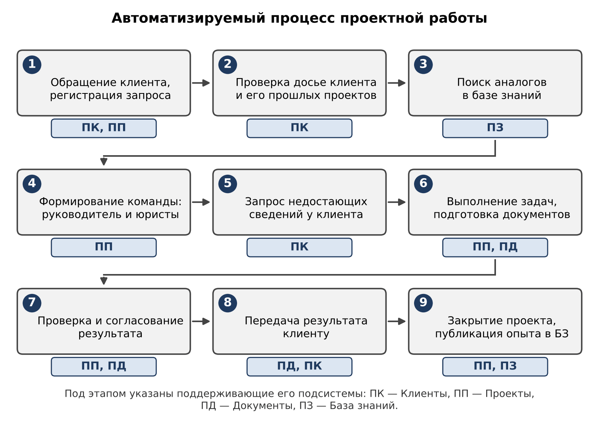
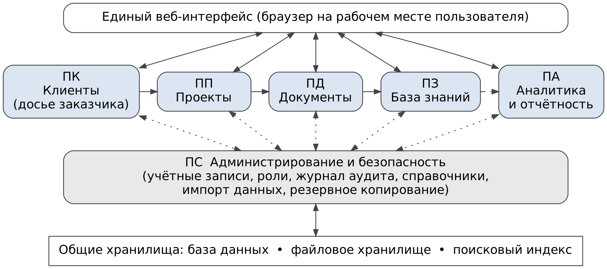
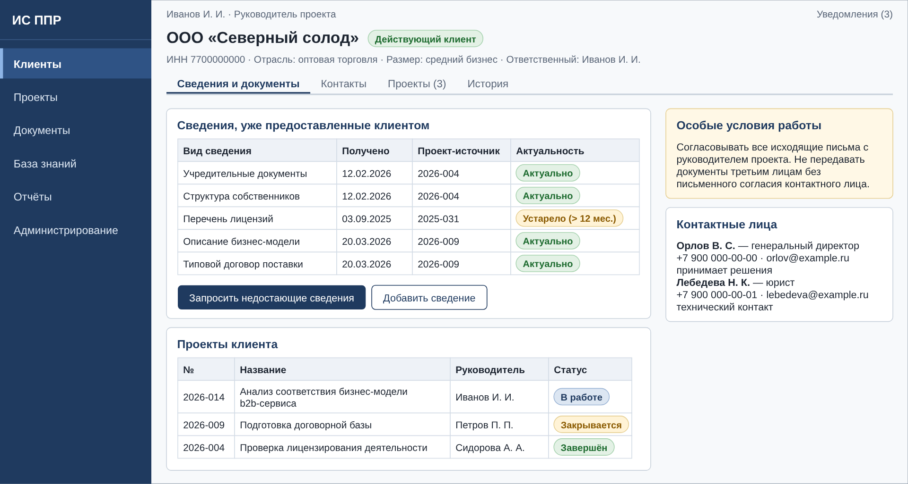
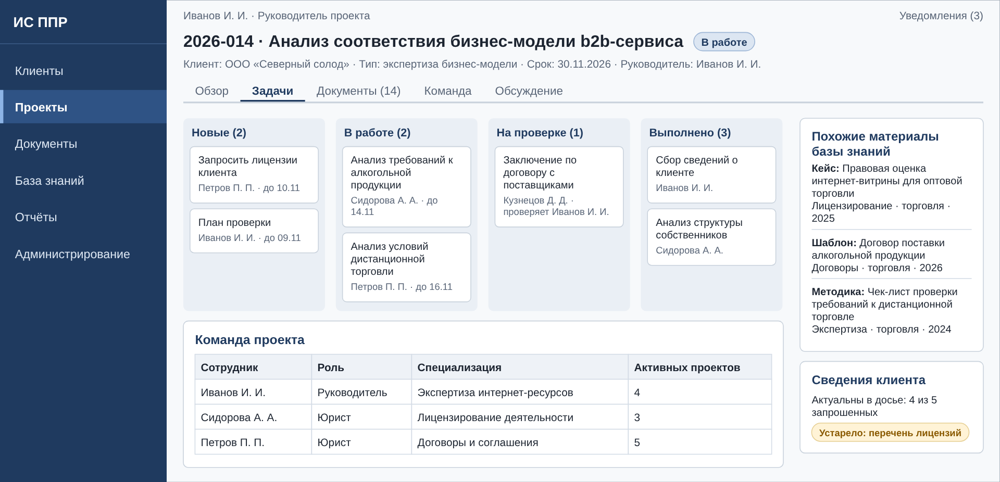
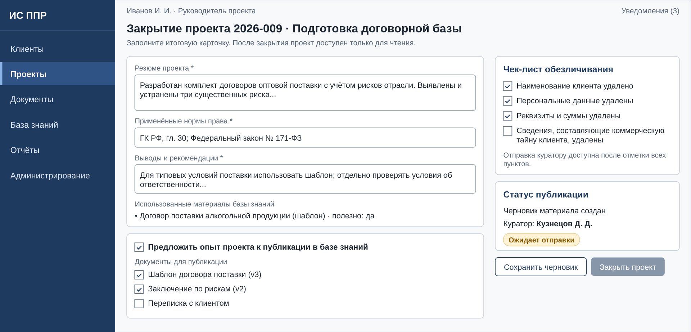
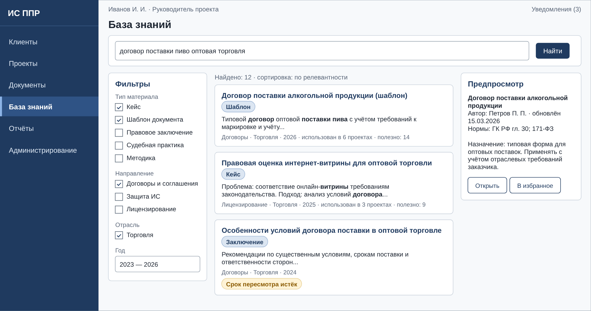
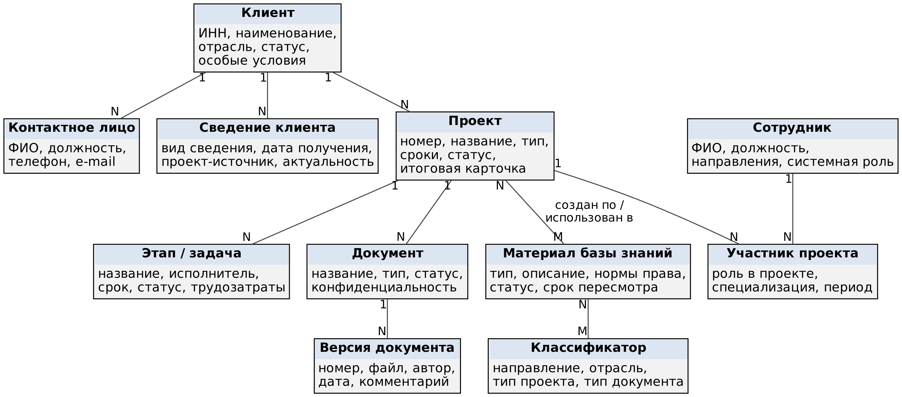

УТВЕРЖДАЮ

**[Должность руководителя Заказчика]**

\_\_\_\_\_\_\_\_\_\_\_\_\_\_ **[ФИО]**

«\_\_\_» \_\_\_\_\_\_\_\_\_\_\_\_ 2026 г.

СОГЛАСОВАНО

**[Должность руководителя Разработчика]**

\_\_\_\_\_\_\_\_\_\_\_\_\_\_ **[ФИО]**

«\_\_\_» \_\_\_\_\_\_\_\_\_\_\_\_ 2026 г.

ТЕХНИЧЕСКОЕ ЗАДАНИЕ

на создание информационной системы поддержки проектной работы юридической компании

(ИС ППР)

Разработано в соответствии с ГОСТ 34.602-2020

Москва, 2026

# 1 Общие сведения

## 1.1 Полное и краткое наименование системы

Полное наименование: информационная система поддержки проектной работы юридической компании.

Краткое наименование: ИС ППР (далее — Система).

## 1.2 Шифр темы или номер договора

Шифр темы не присваивается. Номер и дата договора на создание Системы: _______________. Настоящее техническое задание (далее — ТЗ) является приложением к этому договору.

## 1.3 Наименование организации-заказчика

Юридическая компания, оказывающая юридическую поддержку крупному и среднему бизнесу (далее — Заказчик). Полное наименование, ИНН, адрес и контактное лицо: _______________. Работы выполняются в интересах аналитического отдела Заказчика.

## 1.4 Наименование организации-разработчика

ИТ-компания, выбранная Заказчиком для создания Системы (далее — Разработчик). Полное наименование, ИНН, адрес и контактное лицо: _______________.

## 1.5 Перечень документов, на основании которых создаётся система

1. Договор на создание Системы и настоящее ТЗ.
2. Решение руководства Заказчика о создании Системы: _______________.
3. ГОСТ 34.602-2020 «Информационные технологии. Комплекс стандартов на автоматизированные системы. Техническое задание на создание автоматизированной системы».
4. ГОСТ 34.201-2020 «Комплекс стандартов на автоматизированные системы. Автоматизированные системы. Виды, комплектность и обозначение документов».
5. ГОСТ Р 59793-2021 «Автоматизированные системы. Стадии создания».
6. ГОСТ Р 59792-2021 «Виды испытаний автоматизированных систем».
7. ГОСТ Р 59853-2021 «Информационные технологии. Комплекс стандартов на автоматизированные системы. Автоматизированные системы. Термины и определения».
8. Федеральный закон от 27.07.2006 № 149-ФЗ «Об информации, информационных технологиях и о защите информации».
9. Федеральный закон от 27.07.2006 № 152-ФЗ «О персональных данных».
10. Федеральный закон от 29.07.2004 № 98-ФЗ «О коммерческой тайне».
11. Постановление Правительства РФ от 01.11.2012 № 1119 «Об утверждении требований к защите персональных данных при их обработке в информационных системах персональных данных».
12. Приказ ФСТЭК России от 18.02.2013 № 21 «Об утверждении Состава и содержания организационных и технических мер по обеспечению безопасности персональных данных при их обработке в информационных системах персональных данных».

## 1.6 Плановые сроки начала и окончания работ

Начало работ: _______________. Срок создания Системы и ввода в действие — 12 месяцев с даты начала работ. Окончание работ по созданию Системы — подписание акта приёмки в эксплуатацию. Далее следует гарантийное обслуживание сроком 12 месяцев. Разбивка по этапам приведена в разделе 5.

## 1.7 Общие сведения об источниках и порядке финансирования работ

Работы финансирует Заказчик. Оплата производится по этапам, указанным в разделе 5, на основании актов сдачи-приёмки этапов. Источник финансирования, стоимость и график платежей: _______________.

# 2 Цели и назначение создания системы

## 2.1 Цели создания системы

Система создаётся, чтобы накопленный опыт использовался в новых проектах, а команды согласованно работали с клиентами. Цели и критерии их достижения приведены в таблице 1.

Таблица 1 — Цели создания Системы и критерии их достижения

| № | Цель | Проблема (п. 3.1.3) | Критерий достижения | Способ проверки |
|-----|----------------|-----|----------------------------------|-------------------------|
| Ц-1 | Сократить время поиска материалов из ранее выполненных проектов | 1 | Для 90 % задач из контрольного набора нужный материал найден не более чем за 5 минут. Контрольный набор — не менее 30 поисковых задач, составленных Заказчиком | Замеры при опытной эксплуатации по контрольному набору |
| Ц-2 | Исключить повторные запросы клиенту сведений, которые уже есть у компании | 3 | Доля запросов клиенту, отправленных повторно с подтверждением причины, не более 5 % от всех запросов за период опытной эксплуатации | Отчёт ПА-04 |
| Ц-3 | Собрать проектные данные и документы в едином хранилище | 1, 4 | Все новые проекты, начатые в период опытной эксплуатации, зарегистрированы в Системе; все материалы общей папки, отобранные Заказчиком для переноса, перенесены в Систему | Сверка списка проектов Заказчика с реестром Системы (ПП-12); акт миграции |
| Ц-4 | Согласовать действия проектных команд | 2 | В 100 % активных проектов назначены руководитель, исполнители и сроки задач; статус проекта виден всей команде и руководству | Отчёт ПА-04 |
| Ц-5 | Снизить трудозатраты на подготовительные этапы типовых проектов за счёт повторного использования опыта | 2, 4 | Не менее 50 % проектов, закрытых за 6 месяцев после ввода в действие, используют хотя бы один материал базы знаний (БЗ) | Отчёт ПА-03 |

## 2.2 Назначение системы

Система предназначена для автоматизации следующих видов деятельности аналитического отдела Заказчика:

1. Ведение досье клиентов, включая учёт сведений и документов, полученных от клиента.
2. Управление проектами: формирование команд, постановка задач, контроль сроков, согласование результатов, закрытие проектов.
3. Хранение документов проектов с контролем версий и прав доступа.
4. Накопление, обезличивание и повторное использование опыта выполненных проектов в базе знаний.
5. Формирование отчётности по проектам, клиентам, загрузке сотрудников и использованию базы знаний.

Объекты использования — проектная деятельность аналитического отдела Заказчика и все проекты Заказчика, выполняемые для клиентов. Роли пользователей Системы приведены в таблице 2.

Таблица 2 — Роли пользователей Системы

| Роль | Кто выполняет | Основные действия |
|-----------------|-------------------------|----------------------------------------------|
| Руководитель проекта | Руководитель проектной команды | Регистрирует проект, формирует команду, ставит задачи, согласует результаты, закрывает проект, предлагает опыт проекта в БЗ |
| Юрист-исполнитель | Специалист по направлению (договоры, защита ИС, защита информации и персональных данных (ПДн), лицензирование, экспертиза интернет-ресурсов и др.) | Выполняет задачи, готовит документы, ищет материалы в БЗ, фиксирует трудозатраты |
| Куратор БЗ | Юрист, назначенный ответственным за качество БЗ | Проверяет обезличивание, публикует и пересматривает материалы, ведёт классификаторы БЗ |
| Руководство компании | Руководство Заказчика | Просматривает проекты, клиентов и отчёты |
| Администратор | Сотрудник ИТ-службы Заказчика | Управляет учётными записями, ролями, справочниками, импортом, резервным копированием |

Одна и та же роль может быть назначена нескольким сотрудникам, один сотрудник может иметь несколько ролей.

# 3 Характеристика объектов автоматизации

## 3.1 Основные сведения об объекте автоматизации

### 3.1.1 Объект автоматизации

Объект автоматизации — проектная деятельность аналитического отдела юридической компании, которая оказывает юридическую поддержку крупному и среднему бизнесу.

Деятельность носит проектный характер. Запрос клиента каждый раз новый, поэтому команда изучает новую проблематику и работает с нестандартными случаями. Примеры выполненных проектов:

- анализ соответствия российскому законодательству бизнес-модели b2b-сервиса, интернет-витрины для оптовой дистрибуции крафтового пива;
- подготовка линии защиты по гражданскому иску международной компании к российскому бренду, использующему созвучную торговую марку и схожую цветовую схему;
- экспертиза профильного интернет-сообщества на вероятность привлечения к ответственности за экстремистское содержание высказываний участников;
- подготовка регламента предрейсового контроля водителей карьерных самосвалов с учётом их ресурсного состояния на основе электроэнцефалограммы;
- подготовка рекомендаций по законности хранения пользовательских данных, размещаемых в социальной сети.

Специалисты компании работают по направлениям: составление договоров и соглашений с учётом отраслевых рисков, защита интеллектуальной собственности, защита информации и персональных данных, лицензирование деятельности, экспертиза интернет-ресурсов и другие. В одном проекте могут участвовать специалисты разных направлений. Каждый проект выполняет команда из нескольких юристов и одного руководителя, который координирует их работу. Для одного клиента могут одновременно или последовательно выполняться несколько проектов с разными командами.

### 3.1.2 Описание автоматизируемого бизнес-процесса

Процесс проектной работы состоит из девяти этапов (рисунок 1). Таблица 3 показывает, что происходит на каждом этапе сейчас и какие проблемы это создаёт.

Таблица 3 — Этапы процесса и текущие проблемы

| № | Этап | Содержание этапа | Проблема в текущей работе |
|---|------------------|--------------------------------------|------------------------------------|
| 1 | Обращение клиента, регистрация запроса | Клиент формулирует запрос, руководитель принимает его в работу | Нет единого учёта запросов и клиентов |
| 2 | Проверка досье клиента и его прошлых проектов | Руководитель выясняет, что уже делалось для клиента и какие сведения у компании есть | Единого досье нет, сведения разбросаны по папкам и перепискам |
| 3 | Поиск аналогов в базе знаний | Команда ищет похожие проекты, шаблоны, заключения | Общая папка на сервере: найти нужное очень сложно, опыт не применяется |
| 4 | Формирование команды | Руководитель подбирает юристов нужных направлений | Нет данных о специализациях и загрузке сотрудников |
| 5 | Запрос недостающих сведений у клиента | Команда запрашивает у клиента документы и информацию | Одни и те же сведения запрашивают у клиента повторно разные исполнители |
| 6 | Выполнение задач, подготовка документов | Юристы анализируют законодательство, готовят документы | Нет единых версий документов и общего списка задач |
| 7 | Проверка и согласование результата | Руководитель или коллега проверяет результат | Замечания и решения нигде не фиксируются |
| 8 | Передача результата клиенту | Результат и документы направляются клиенту | Нет единой истории взаимодействия с клиентом |
| 9 | Закрытие проекта и публикация опыта | Проект закрывается, полезный опыт сохраняется | Опыт оседает в общей папке и практически не применяется в дальнейшем |

### 3.1.3 Текущее состояние

Сотрудники пользуются одной общей папкой на сервере. Из-за этого:

1. Накопленные кейсы и примеры трудно найти, поэтому опыт коллег не применяется в новых проектах.
2. Растут трудозатраты и возникает несогласованность действий юристов, работающих с разными клиентами.
3. Когда для одного клиента выполняется несколько проектов с разными исполнителями, компания несколько раз запрашивает у клиента одну и ту же информацию.
4. Знания, накопленные в одном проекте, не учитываются в других проектах.

Эти проблемы определяют цели создания Системы (таблица 1).

### 3.1.4 Количественные характеристики объекта

Количественные параметры, на которые рассчитана Система, приведены в таблице 4. Значения приняты как допущение для расчёта нагрузки.

Таблица 4 — Количественные характеристики

| Показатель | Значение, принятое для расчёта |
|--------------------------------------------|----------------------|
| Число пользователей Системы | до 100 |
| Число одновременно работающих пользователей | до 30 |
| Объём данных на момент ввода в действие, включая перенос из общей папки | до 1 ТБ |
| Рост объёма данных | до 500 ГБ в год |
| Объём БЗ | до 20 000 материалов |
| Общее число документов в хранилище | до 500 000 |

## 3.2 Условия эксплуатации объекта автоматизации и характеристики окружающей среды

Система эксплуатируется в офисной среде Заказчика. Пользователи работают с Системой с рабочих мест (персональные компьютеры с браузером) в локальной вычислительной сети (ЛВС) Заказчика, а также удалённо через защищённый канал связи (требования — в разделе 4.4.8). Серверная часть размещается на серверах Заказчика на территории Российской Федерации. Рабочие дни и часы Заказчика: по рабочим дням с 08:00 до 20:00. Особых требований к окружающей среде нет: серверное оборудование и рабочие места эксплуатируются в условиях, установленных их изготовителями.

# 4 Требования к системе

## 4.1 Требования к структуре системы в целом

### 4.1.1 Перечень подсистем, их назначение и основные характеристики, требования к числу уровней иерархии и степени централизации

Система состоит из шести функциональных подсистем (таблица 5, рисунок 2).

Таблица 5 — Подсистемы Системы

| Код | Подсистема | Назначение | Основные характеристики |
|-----|------------|----------------------------|--------------------------------------|
| ПК | Клиенты | Ведение единого досье клиента, исключение повторных запросов клиенту | Карточка клиента, контакты, реестр полученных сведений и документов, история взаимодействий, связь с проектами |
| ПП | Проекты | Управление проектами и командами | Регистрация, команды, этапы и задачи, сроки, уведомления, трудозатраты, согласование, закрытие проекта |
| ПД | Документы | Хранение документов проектов и клиентов | Версии, статусы, шаблоны, права доступа, предпросмотр, индексация |
| ПЗ | База знаний | Накопление и повторное использование обезличенного опыта | Типы материалов, классификаторы, публикация из проектов, поиск, рекомендации похожих материалов |
| ПА | Аналитика и отчётность | Контроль хода проектов и достижения целей Системы | Стандартные отчёты, показатели целей, конструктор простых отчётов, экспорт, рассылка по расписанию |
| ПС | Администрирование и безопасность | Управление доступом, справочниками, данными и состоянием Системы | Учётные записи, роли, журнал аудита, классификаторы, импорт из общей папки, резервное копирование, настройки |

Требования к числу уровней иерархии: Система должна иметь три уровня — уровень представления (веб-интерфейс), уровень приложения (серверная логика и программный интерфейс) и уровень данных (база данных, файловое хранилище, поисковый индекс).

Требования к степени централизации: Система должна быть централизованной, с единой базой данных и единым файловым хранилищем для всех подсистем. Подсистемы должны работать с общим справочником клиентов, сотрудников и классификаторов без дублирования данных.

### 4.1.2 Требования к способам и средствам связи для информационного обмена между компонентами системы

1. Пользователи должны работать с Системой через веб-интерфейс по протоколу HTTPS с версией TLS не ниже 1.2. Установка клиентского программного обеспечения на рабочие места не допускается.
2. Взаимодействие между веб-интерфейсом и серверной частью, а также внешние интеграции должны выполняться через программный интерфейс REST с форматом обмена JSON.
3. Взаимодействие серверных компонентов Системы друг с другом должно происходить внутри сети Заказчика; каналы между компонентами, расположенными на разных серверах, должны быть защищены шифрованием.
4. Удалённый доступ пользователей должен выполняться только через защищённый канал связи Заказчика (VPN) или с двухфакторной аутентификацией (требования — в разделе 4.4.8).

### 4.1.3 Требования к характеристикам взаимосвязей создаваемой системы со смежными системами

Таблица 6 — Взаимосвязи со смежными системами

| Смежная система | Направление обмена | Назначение | Способ интеграции |
|----------------|-----------------|-------------------------|-----------------------------|
| Служба каталогов Заказчика | Из службы каталогов в Систему | Аутентификация, синхронизация учётных записей и подразделений | LDAP поверх TLS; единый вход (SSO), если его поддерживает служба каталогов |
| Почтовый сервер Заказчика | Из Системы | Отправка уведомлений и писем клиентам по шаблонам | SMTP с шифрованием TLS |
| Общая папка на сервере Заказчика | В Систему | Источник материалов для миграции (ПС-05) | Доступ по сети к файловому ресурсу или загрузка пакета файлов администратором |
| Система резервного копирования Заказчика | Из Системы | Хранение резервных копий | Способ определяется техническим проектом и согласуется с Заказчиком |

Система не должна требовать изменений в конфигурации смежных систем, кроме создания служебных учётных записей и параметров доступа.

### 4.1.4 Требования к режимам функционирования системы

1. Штатный режим: все функции доступны пользователям. Доступность в штатном режиме — по разделу 4.4.3.
2. Режим обслуживания: выполняются обновление, резервное копирование и восстановление. Окна обслуживания назначаются вне рабочих часов Заказчика, длительностью не более 4 часов, с уведомлением пользователей не менее чем за 2 рабочих дня.
3. Режим «только чтение»: при сбое записи в хранилище, при восстановлении из копии и по команде администратора Система должна оставаться доступной для просмотра и поиска, а запись данных блокировать с понятным сообщением пользователю.
4. Режим миграции: во время импорта данных из общей папки (ПС-05) Система должна оставаться доступной пользователям; импортируемые материалы появляются в Системе после завершения проверки и подтверждения импорта администратором.

### 4.1.5 Требования по диагностированию системы

1. Система должна записывать в журнал событий ошибки приложения, ошибки интеграций и сбои фоновых задач. Записи должны храниться не менее 90 дней.
2. Администратору должна быть доступна панель состояния: доступность сервисов, время отклика, длина очереди индексации, свободное место в хранилищах, результат последнего резервного копирования, состояние связи со смежными системами.
3. Система должна отправлять администратору уведомление по e-mail при критических событиях: недоступность сервиса, сбой резервного копирования, остаток свободного места менее 15 %, потеря связи со службой каталогов.
4. Система должна давать возможность запустить проверку целостности поискового индекса и его перестроение без остановки работы пользователей.

### 4.1.6 Перспективы развития, модернизации системы

Архитектура Системы должна допускать без переработки ядра:

1. добавление клиентского портала для обмена документами и сведениями с клиентами;
2. интеграцию со справочно-правовыми системами;
3. интеграцию с системами электронной подписи и электронного документооборота;
4. увеличение числа пользователей и объёма данных в два раза относительно таблицы 4 за счёт добавления вычислительных ресурсов;
5. добавление новых типов материалов БЗ, классификаторов и отчётов без изменения программного кода — настройками.

Программный интерфейс Системы должен быть документирован и открыт для интеграции. Перечисленные пункты в объём создания Системы не входят.

## 4.2 Требования к функциям (задачам), выполняемым системой

### 4.2.1 Временной регламент реализации каждой функции

Таблица 7 — Временной регламент

| Функция | Режим выполнения | Регламент |
|--------------------------------|------------------------|----------------------------------|
| Ввод, просмотр и изменение данных во всех подсистемах | По запросу пользователя | В рабочие часы Заказчика; время отклика — по разделу 4.4.2 |
| Поиск (ПК-09, ПП-12, ПД-08, ПЗ-05) | По запросу пользователя | Время выполнения — по разделу 4.4.2 |
| Индексация загруженных документов и материалов БЗ | Автоматически при загрузке или изменении | Не позднее 5 минут после загрузки; для сканов с распознаванием текста — не позднее 15 минут |
| Уведомления о задачах (ПП-06) | Автоматически при событии | Не позднее 1 минуты после события |
| Напоминания о приближающихся сроках и просрочках (ПП-06) | По расписанию | Ежедневно в 09:00 |
| Установка признака «устарело» для сведений клиента (ПК-04) | По расписанию | Ежедневно в 01:00 |
| Контроль срока пересмотра материалов БЗ (ПЗ-04) | По расписанию | Еженедельно, по понедельникам в 08:00 |
| Стандартные отчёты (ПА-01 – ПА-04) | По запросу пользователя | Не более 30 секунд на формирование |
| Рассылка отчётов (ПА-07) | По расписанию | По умолчанию ежемесячно, 1-го числа в 08:00; расписание настраивается |
| Резервное копирование (ПС-06) | По расписанию | Ежедневно в 02:00 (инкрементальное); полное — по воскресеньям в 02:00 |
| Импорт из общей папки (ПС-05) | По запросу администратора | Скорость обработки не менее 20 ГБ в час |
| Запись в журнал аудита (ПС-03) | Автоматически при каждом событии | Одновременно с действием пользователя |

### 4.2.2 Требования к реализации каждой функции

Требования сгруппированы по подсистемам. Каждое требование имеет уникальный номер и проверяется при испытаниях (раздел 7). Макеты экранов на рисунках 3–6 показывают состав элементов и логику работы, но не определяют точный дизайн. Данные на макетах вымышлены.

#### 4.2.2.1 Подсистема «Клиенты» (ПК)

Таблица 8 — Требования к функциям подсистемы ПК

| № | Требование |
|-------|------------------------------------------------------------------|
| ПК-01 | Система должна позволять создавать, изменять и архивировать карточку клиента с полями: наименование, ИНН, ОГРН, адрес, отрасль (из классификатора), размер бизнеса (крупный, средний), сайт, статус (потенциальный, действующий, архивный), ответственный сотрудник. Обязательные поля — наименование, ИНН, отрасль, статус |
| ПК-02 | При создании карточки Система должна проверять дубликаты: при совпадении ИНН — запрещать создание; при похожем наименовании — предупреждать и показывать найденные карточки |
| ПК-03 | Система должна хранить контактные лица клиента: ФИО, должность, телефон, e-mail, роль (принимает решения, технический контакт, иная), отметку о согласии на обработку ПДн и дату согласия |
| ПК-04 | Система должна вести реестр сведений и документов, полученных от клиента: вид сведения (из классификатора), дата получения, проект-источник, ссылка на документ, срок актуальности (по умолчанию 12 месяцев, настраивается по виду сведения). Признак «устарело» должен устанавливаться автоматически по истечении срока актуальности |
| ПК-05 | При подготовке запроса клиенту в проекте Система должна показывать сведения, которые уже есть в досье, с датой получения и признаком актуальности, и формировать список недостающих или устаревших сведений. Если пользователь запрашивает сведение, актуальное в досье, Система должна потребовать указать причину повторного запроса и сохранить её. Запрос клиенту должен оформляться письмом по шаблону и фиксироваться в истории взаимодействий |
| ПК-06 | Система должна вести историю взаимодействий с клиентом: тип события (обращение, встреча, звонок, письмо), дата, участники, краткое содержание, проект, вложения. Изменение и удаление записей должно фиксироваться в журнале аудита |
| ПК-07 | В карточке клиента Система должна показывать все проекты клиента, текущие и завершённые: номер, название, статус, руководитель, команда, дата закрытия, с переходом в карточку проекта и в его итоговую карточку |
| ПК-08 | Система должна хранить для клиента поле «Особые условия работы» (свободный текст) и показывать его всем участникам проектов этого клиента в карточке клиента и в карточке проекта. Изменять поле могут руководитель проекта и руководство компании |
| ПК-09 | Система должна обеспечивать поиск и фильтрацию клиентов по наименованию (в том числе по части названия), ИНН, отрасли, статусу, ответственному сотруднику и наличию активных проектов |

#### 4.2.2.2 Подсистема «Проекты» (ПП)

Таблица 9 — Требования к функциям подсистемы ПП

| № | Требование |
|-------|------------------------------------------------------------------|
| ПП-01 | Система должна регистрировать проект с полями: номер, название, клиент, тип проекта (из классификатора), описание запроса, дата начала, плановая дата завершения, приоритет (низкий, обычный, высокий), статус (новый, в работе, приостановлен, закрыт), номер договора с клиентом (необязательно). Номер вида «ГГГГ-NNN» присваивается автоматически и уникален. Обязательные поля — клиент, название, тип, описание запроса, плановая дата завершения. Если клиента нет в Системе, его карточку можно создать из формы регистрации |
| ПП-02 | Система должна позволять сформировать команду проекта: ровно один руководитель и не менее одного юриста-исполнителя; для каждого участника указывается направление работы. При выборе сотрудника Система должна показывать его направления и число активных проектов и задач. Проект нельзя перевести в статус «В работе» без руководителя и исполнителя |
| ПП-03 | При регистрации проекта и в его карточке Система должна показывать: прошлые проекты клиента; перечень сведений клиента, которых не хватает относительно перечня, заданного для типа проекта; до 10 похожих материалов БЗ (ПЗ-06) |
| ПП-04 | Система должна поддерживать структуру «проект – этап – задача». Задача имеет поля: название, описание, исполнитель, срок, приоритет, статус (новая, в работе, на проверке, выполнена, отменена), зависимость от другой задачи (необязательно), вложения. Этапы и задачи могут создаваться по шаблону для типа проекта |
| ПП-05 | Система должна показывать задачи проекта в двух представлениях: списком с фильтрами и сортировкой и канбан-доской по статусам. Перенос карточки задачи на доске должен изменять её статус |
| ПП-06 | Система должна отправлять уведомления в интерфейсе и по e-mail: о назначении задачи; о приближении срока (за 2 рабочих дня); о просрочке (в день просрочки и далее каждый рабочий день до выполнения); о смене статуса задачи; о комментарии с упоминанием пользователя; об изменении состава команды; о публикации материала куратором. Пользователь может отключить e-mail-уведомления по типам событий, кроме назначения задачи и просрочки |
| ПП-07 | Система должна поддерживать комментарии к проекту и задаче, упоминание коллеги через «@» и историю изменений полей (кто, когда, прежнее и новое значение) |
| ПП-08 | Система должна принимать от исполнителя затраченные часы по задаче с датой и показывать итоги по задаче, проекту и сотруднику. Изменять чужие записи может только руководитель проекта |
| ПП-09 | Исполнитель должен иметь возможность перевести задачу в статус «на проверке» и выбрать проверяющего — другого юриста проекта или руководителя. Проверяющий принимает результат или возвращает на доработку с обязательным замечанием. Проверяющим не может быть исполнитель задачи. История решений должна храниться |
| ПП-10 | Система должна требовать при закрытии проекта заполнить итоговую карточку: резюме проекта; применённые нормы права; выводы и рекомендации; использованные материалы БЗ с отметкой «полезно / не полезно»; решение о предложении опыта проекта в БЗ и выбор документов для него (рисунок 5). Проект нельзя закрыть при наличии незавершённых задач, кроме отменённых. После закрытия проект доступен только для чтения; переоткрыть его может только руководитель проекта с указанием причины, которая фиксируется |
| ПП-11 | Руководитель проекта должен иметь возможность добавлять и исключать участников команды. Исключённый участник теряет доступ к проекту. Задачи исключаемого участника должны быть переназначены до исключения. История состава команды должна сохраняться |
| ПП-12 | Система должна показывать реестр проектов с фильтрами по клиенту, статусу, типу, руководителю, участнику, направлению и периоду и с поиском по названию и номеру |

#### 4.2.2.3 Подсистема «Документы» (ПД)

Таблица 10 — Требования к функциям подсистемы ПД

| № | Требование |
|-------|------------------------------------------------------------------|
| ПД-01 | Система должна принимать документы через загрузку по кнопке и перетаскиванием, в том числе пакетную. Допустимые форматы: DOCX, DOC, XLSX, XLS, PPTX, ODT, ODS, PDF, RTF, TXT, JPG, PNG, EML, MSG, ZIP. Максимальный размер файла — 200 МБ |
| ПД-02 | Для документа Система должна хранить метаданные: название, тип документа (из классификатора), проект, клиент, автор, дата, статус, уровень конфиденциальности (обычный, ограниченный), теги |
| ПД-03 | Система должна хранить все версии документа с указанием автора, даты и комментария. Пользователь должен иметь возможность скачать любую версию и сделать любую версию текущей. Система должна предупреждать о том, что документ редактирует другой пользователь |
| ПД-04 | Документ должен иметь статус: черновик, на согласовании, утверждён, архив. Смену статуса фиксирует журнал изменений. Утверждённый документ нельзя изменить, кроме создания новой версии |
| ПД-05 | Система должна вести каталог шаблонов документов с версиями. Создание документа из шаблона в формате DOCX должно подставлять поля: наименование и ИНН клиента, номер и название проекта, ФИО руководителя проекта, дату |
| ПД-06 | Система должна показывать документы форматов PDF, DOCX, XLSX, PPTX, TXT и изображения в браузере без скачивания |
| ПД-07 | Права на документ должны наследоваться от проекта: по умолчанию доступ имеют участники проекта и руководство компании. Для документа с уровнем «ограниченный» доступ получают только выбранные участники и руководитель проекта |
| ПД-08 | Система должна выполнять полнотекстовый поиск по названию, метаданным и содержимому документов. Для сканов и изображений в PDF должно выполняться распознавание текста при загрузке |
| ПД-09 | Система должна позволять скачать выбранные документы одним архивом и выгрузить реестр документов проекта в XLSX |
| ПД-10 | При загрузке Система должна сравнивать контрольную сумму файла с уже загруженными файлами и предупреждать о дубликате; пользователь может подтвердить загрузку |
| ПД-11 | Удалённый документ должен попадать в корзину на 30 дней, откуда его можно восстановить. Окончательное удаление выполняется автоматически по истечении 30 дней либо администратором |

#### 4.2.2.4 Подсистема «База знаний» (ПЗ)

Таблица 11 — Требования к функциям подсистемы ПЗ

| № | Требование |
|-------|------------------------------------------------------------------|
| ПЗ-01 | Система должна поддерживать типы материалов БЗ: кейс (итог выполненного проекта), правовое заключение, шаблон документа, судебная практика, методика или регламент, справка по норме права |
| ПЗ-02 | Карточка материала должна содержать: название, тип, краткое описание (проблема, подход, результат), направление (из классификатора), отрасль (из классификатора), применимое законодательство (закон, статья), ключевые слова, автора, дату, срок пересмотра, статус (черновик, на проверке, опубликован, устарел), вложения |
| ПЗ-03 | При закрытии проекта с решением о публикации (ПП-10) Система должна создать черновик материала БЗ с копированием резюме, норм права и выбранных документов. Наименование клиента и его реквизиты в черновик не копируются. Публикация должна быть невозможна, пока автор не отметил все пункты чек-листа обезличивания: наименование клиента, ПДн, реквизиты и суммы, сведения, составляющие коммерческую тайну клиента |
| ПЗ-04 | Материал должен проходить проверку: черновик – на проверке у куратора – опубликован или возвращён автору с замечанием. Срок пересмотра материала по умолчанию 12 месяцев. За 14 дней до истечения срока Система должна уведомить автора и куратора, после истечения — показывать у материала пометку «срок пересмотра истёк». Куратор может пометить материал как «устарел» |
| ПЗ-05 | Система должна выполнять поиск по БЗ: полнотекстовый по названию, описанию и содержимому вложений; с учётом морфологии русского языка; с точной фразой и операторами И, ИЛИ, НЕ; с фильтрами по типу материала, направлению, отрасли, году, автору, законодательству; с сортировкой по релевантности и дате; с подсветкой найденных слов и предпросмотром материала (рисунок 6). Пользователь может сохранить поисковый запрос |
| ПЗ-06 | Для проекта и для материала Система должна показывать до 10 похожих материалов БЗ, ранжированных по совпадению направления, отрасли, ключевых слов и норм права. Пользователь может отметить рекомендацию «полезно / не полезно» |
| ПЗ-07 | Система должна хранить связи «материал – проект, в котором он использован» и «материал – материал», показывать у материала число проектов, в которых он использован |
| ПЗ-08 | Куратор должен иметь возможность вести иерархические классификаторы БЗ: направления, отрасли, типы материалов. Удаление значения, которое используется, запрещено; его можно пометить как неактуальное |
| ПЗ-09 | Пользователь должен иметь возможность добавить материал в избранное и подписаться на направление, отрасль или тег с уведомлением о новых опубликованных материалах |
| ПЗ-10 | Пользователь должен иметь возможность оценить материал («полезно» или «не полезно») и оставить комментарий. Оценки и комментарии видны авторам и куратору |

#### 4.2.2.5 Подсистема «Аналитика и отчётность» (ПА)

Таблица 12 — Требования к функциям подсистемы ПА

| № | Требование |
|-------|------------------------------------------------------------------|
| ПА-01 | Система должна формировать отчёты по проектам: список проектов по статусам, срокам, клиентам, типам; доля проектов, закрытых в срок; просроченные проекты и задачи |
| ПА-02 | Система должна формировать отчёт по загрузке сотрудников: число активных проектов и задач, затраченные часы за период по сотрудникам и направлениям |
| ПА-03 | Система должна формировать отчёт по БЗ: число материалов по типам, направлениям и отраслям; наиболее используемые материалы; материалы с истёкшим сроком пересмотра; доля закрытых проектов, использовавших материалы БЗ; поисковые запросы без результата |
| ПА-04 | Система должна показывать панель показателей достижения целей: число зарегистрированных проектов за период; доля активных проектов, в которых назначены руководитель, исполнители и сроки задач; доля запросов клиентам, отправленных повторно с подтверждением причины; доля закрытых проектов с использованными материалами БЗ; число поисковых запросов и доля запросов, завершившихся открытием материала |
| ПА-05 | Система должна экспортировать отчёты в форматы XLSX, CSV и PDF |
| ПА-06 | Система должна позволять пользователю с правом на отчёты создать отчёт в конструкторе: выбор полей, фильтров и группировок по данным проектов, клиентов, документов, материалов БЗ — и сохранить его |
| ПА-07 | Система должна отправлять выбранные отчёты по e-mail адресатам по расписанию, заданному администратором |
| ПА-08 | Данные отчётов должны учитывать права доступа пользователя: пользователь не видит в отчёте данные проектов, к которым у него нет доступа, кроме руководства компании |

#### 4.2.2.6 Подсистема «Администрирование и безопасность» (ПС)

Таблица 13 — Требования к функциям подсистемы ПС

| № | Требование |
|-------|------------------------------------------------------------------|
| ПС-01 | Система должна позволять администратору создавать, изменять и блокировать учётные записи, а также синхронизировать их со службой каталогов Заказчика. Пользователь должен проходить аутентификацию логином и паролем или через единый вход |
| ПС-02 | Система должна поддерживать роли: руководитель проекта, юрист-исполнитель, куратор БЗ, руководство компании, администратор (таблица 2), и разграничивать права на уровне клиента, проекта и документа. Матрица прав должна настраиваться администратором |
| ПС-03 | Система должна вести журнал аудита: вход и выход, неудачные попытки входа, просмотр документов с уровнем «ограниченный», создание, изменение и удаление данных, смена прав, экспорт данных. Запись содержит дату и время, пользователя, действие, объект. Журнал не должен допускать изменения и удаления записей, включая администраторов. Срок хранения — не менее 3 лет. Журнал должен допускать поиск и выгрузку |
| ПС-04 | Администратор и куратор БЗ должны иметь возможность вести справочники и классификаторы: отрасли, направления, типы проектов, типы документов, виды сведений клиента, типы материалов, шаблоны этапов проектов |
| ПС-05 | Система должна выполнять пакетный импорт файлов из общей папки: загрузка с сохранением структуры каталогов, имён файлов, дат создания и изменения; присвоение метаданных из реестра в формате CSV; режим проверки без записи с выдачей отчёта; обнаружение дубликатов; итоговый отчёт об импорте с перечнем загруженных и отклонённых файлов |
| ПС-06 | Система должна выполнять резервное копирование базы данных, файлового хранилища и настроек по расписанию (таблица 7) и позволять восстановить данные из копии. Копии ежедневные хранятся 30 дней, ежемесячные — 12 месяцев |
| ПС-07 | Администратор должен иметь возможность настраивать: параметры уведомлений, шаблоны писем клиентам, сроки хранения проектов и корзины, сроки актуальности сведений клиента, политику паролей |
| ПС-08 | Система должна показывать администратору панель состояния и журнал событий по разделу 4.1.5 |

### 4.2.3 Перечень и критерии отказов для каждой функции

Таблица 14 — Отказы функций

| Функция | Отказ | Критерий отказа |
|----------------------|-------------------------------------|-----------------------------------|
| Вход в Систему (ПС-01) | Пользователь с действующей учётной записью не может войти | Система не принимает верные учётные данные в штатном режиме более 1 минуты |
| Поиск (ПК-09, ПП-12, ПД-08, ПЗ-05) | Поиск не возвращает результат или возвращает неполный | Нет результата дольше 10 секунд; не найден проиндексированный документ или материал при запросе по его точному названию |
| Загрузка и версии документов (ПД-01, ПД-03) | Документ потерян, повреждён или недоступен | Файл после загрузки не открывается или не совпадает с исходным по контрольной сумме; версия документа недоступна |
| Права доступа (ПС-02, ПД-07) | Нарушение разграничения прав | Пользователь получил доступ к данным, на которые у него нет права; или лишён доступа, на который имеет право |
| Уведомления (ПП-06) | Уведомление не доставлено | Уведомление о назначении задачи или просрочке не появилось в Системе в течение 5 минут после события |
| Закрытие проекта и публикация (ПП-10, ПЗ-03) | Обход обязательных проверок | Проект закрыт без итоговой карточки; материал опубликован без отмеченного чек-листа обезличивания |
| Журнал аудита (ПС-03) | Нарушение полноты журнала | Событие из перечня ПС-03 не записано или запись изменена |
| Отчёты (ПА-01 – ПА-05) | Неверные данные отчёта | Данные отчёта расходятся с данными подсистем-источников |
| Резервное копирование (ПС-06) | Копия не создана или не восстанавливается | Копия по расписанию не создана; тестовое восстановление не удалось |
| Импорт (ПС-05) | Потеря или искажение данных при импорте | Количество или содержимое импортированных файлов не соответствует отчёту проверки |

## 4.3 Требования к видам обеспечения

### 4.3.1 Требования к математическому обеспечению

1. Ранжирование результатов поиска (ПЗ-05) должно учитывать: совпадение слов запроса в названии (наибольший вес), в описании и в содержимом вложений; совпадение словоформ; статус материала (опубликованные выше устаревших); оценки «полезно». Веса должен настраивать администратор без изменения программного кода.
2. Подбор похожих материалов (ПЗ-06) должен вычислять сходство как взвешенную сумму совпадений по направлению, отрасли, нормам права и ключевым словам. Веса по умолчанию: направление — 0,3; отрасль — 0,2; нормы права — 0,3; ключевые слова — 0,2. Веса настраиваются администратором.
3. Проверка дубликатов клиентов по наименованию (ПК-02) должна выполняться после нормализации наименования: без учёта регистра, кавычек и организационно-правовой формы.
4. Сроки «2 рабочих дня» и «рабочие дни» должны вычисляться по производственному календарю Российской Федерации. Календарь должен обновляться администратором.

### 4.3.2 Требования к информационному обеспечению

1. Состав и структура данных Системы определяются моделью данных (рисунок 7). Разработчик уточняет модель в техническом проекте, не удаляя перечисленные сущности и связи.
2. Система должна использовать единую базу данных и единый справочник клиентов, сотрудников и классификаторов для всех подсистем.
3. Система должна обеспечивать целостность данных: контроль обязательных полей, ссылочную целостность, уникальность ИНН клиента и номера проекта, атомарность операций записи.
4. Сроки хранения данных: проекты и документы — не менее 5 лет после закрытия проекта (срок настраивается ПС-07); журнал аудита — не менее 3 лет; журнал событий — не менее 90 дней; корзина — 30 дней; материалы БЗ — до решения куратора об удалении.
5. Целенаправленная обработка специальных категорий и биометрических ПДн в Системе не предусмотрена. Если такие данные содержатся в документе клиента, документ должен иметь уровень конфиденциальности «ограниченный».
6. Материалы БЗ не должны содержать данных, по которым можно определить клиента (ПЗ-03).
7. Обмен данными с другими системами и экспорт должны использовать форматы CSV, XLSX, DOCX, PDF и JSON.

### 4.3.3 Требования к лингвистическому обеспечению

1. Интерфейс, сообщения, справочники, уведомления и документация должны быть на русском языке.
2. Данные должны храниться в кодировке UTF-8. Даты должны отображаться в формате ДД.ММ.ГГГГ.
3. Поиск должен учитывать морфологию русского языка и считать равными буквы «е» и «ё». Текст на английском языке в документах должен индексироваться.
4. Администратор должен иметь возможность вести справочник синонимов поиска (например, «ПДн» и «персональные данные»).
5. Сообщения об ошибках должны объяснять причину и действие пользователя и не содержать технических кодов без пояснения.

### 4.3.4 Требования к программному обеспечению

1. Система должна быть веб-приложением. Пользователь должен работать с ней в браузере без установки программ. Поддерживаются две последние версии браузеров Google Chrome, Microsoft Edge, Mozilla Firefox и «Яндекс Браузер».
2. Серверная часть должна работать под управлением операционной системы Linux; конкретный дистрибутив (допускаются российские) согласуется в техническом проекте.
3. Хранение данных должно выполняться в реляционной системе управления базами данных (СУБД) с открытой лицензией (PostgreSQL или аналог) с согласованием выбора в техническом проекте.
4. Лицензии стороннего программного обеспечения должны разрешать коммерческое использование Заказчиком и не требовать платы за число пользователей сверх указанного в договоре. Права на результаты разработки определяются договором.
5. Обновление Системы должно выполняться без потери данных и настроек, с возможностью отката к предыдущей версии.
6. Версия Системы должна отображаться в интерфейсе.

### 4.3.5 Требования к техническому обеспечению

Параметры в таблице 15 приведены как минимальные для нагрузки из таблицы 4. Разработчик уточняет конфигурацию в техническом проекте.

Таблица 15 — Минимальные технические требования

| Компонент | Требование |
|-----------------------|------------------------------------------------------|
| Сервер приложений | 8 виртуальных процессоров, 16 ГБ оперативной памяти, 100 ГБ дискового пространства |
| Сервер базы данных и поискового индекса | 8 виртуальных процессоров, 32 ГБ оперативной памяти, быстрые диски (SSD) |
| Файловое хранилище | Не менее 2 ТБ с возможностью расширения не менее чем на 500 ГБ в год |
| Хранилище резервных копий | Отдельное от производственного, объёмом не менее удвоенного объёма данных |
| Серверная сеть | Не менее 1 Гбит/с |
| Рабочее место пользователя | Персональный компьютер с оперативной памятью не менее 4 ГБ, разрешением экрана не менее 1366×768, браузером по п. 4.3.4, сетевым подключением не менее 100 Мбит/с |
| Тестовый контур | Отдельная среда для проверки обновлений, развёртываемая по тем же инструкциям, что и производственная |

Серверное оборудование и виртуализацию для Системы предоставляет Заказчик.

### 4.3.6 Требования к метрологическому обеспечению

Требования не предъявляются по причине того, что Система не содержит измерительных каналов и не выполняет измерений физических величин.

### 4.3.7 Требования к организационному обеспечению

1. Заказчик должен назначить: администратора Системы и его заместителя; не менее одного куратора БЗ; ответственного за защиту информации и ПДн; ключевых пользователей для согласования требований и испытаний — по одному от каждой роли.
2. Заказчик должен утвердить: регламент работы с БЗ (обезличивание, проверка, периодичность пересмотра); регламент доступа и ролей; порядок действий при сбоях и восстановлении.
3. Руководители проектов должны вести проекты, клиентов и документы только в Системе.
4. После переноса данных общая папка на сервере должна быть переведена в режим «только чтение».

### 4.3.8 Требования к методическому обеспечению

1. Разработчик должен передать Заказчику руководство пользователя, руководство администратора и инструкцию куратору БЗ, включающую методику обезличивания материалов.
2. Разработчик должен подготовить краткие памятки по ролям (не более 2 страниц каждая).
3. Методика формирования контрольного набора поисковых задач для проверки цели Ц-1 должна входить в программу и методику испытаний.

## 4.4 Общие технические требования к АС

### 4.4.1 Требования к численности и квалификации персонала системы и режиму его работы

1. Администратор Системы (не менее одного сотрудника и заместитель) должен иметь навыки администрирования серверных ОС Linux, СУБД, сетей и служб каталогов.
2. Куратор БЗ (не менее одного юриста) должен знать классификаторы направлений и отраслей и порядок обезличивания.
3. Пользователи должны уметь работать с браузером и офисными документами; специальных ИТ-знаний не требуется. Число пользователей — по таблице 4.
4. Режим работы персонала — по рабочим дням Заказчика. Круглосуточное дежурство для эксплуатации Системы не требуется.

### 4.4.2 Требования к показателям назначения

Таблица 16 — Показатели назначения

| Показатель | Значение |
|--------------------------------------------------|------------------------------------------|
| Число пользователей | До 100 именованных; до 30 одновременно без ухудшения показателей. При нагрузочных испытаниях — 50 одновременно |
| Объём данных | До 500 000 документов, до 20 000 материалов БЗ, до 2 ТБ в хранилище |
| Время отклика: открытие карточки клиента, проекта, материала БЗ | Не более 2 с |
| Время отклика: сохранение формы | Не более 2 с |
| Время отклика: поиск | Не более 3 с |
| Время отклика: открытие предпросмотра документа до 20 МБ | Не более 5 с |
| Время отклика: загрузка файла 50 МБ при канале 100 Мбит/с | Не более 30 с |
| Формирование стандартного отчёта | Не более 30 с |
| Масштабируемость | Рост нагрузки и объёма данных в 2 раза без изменения архитектуры, за счёт добавления ресурсов |

Время отклика соблюдается для 95 % операций при 30 одновременно работающих пользователях и объёме данных из таблицы.

### 4.4.3 Требования к надёжности

Таблица 17 — Показатели надёжности

| Показатель | Значение |
|----------------------------------------|---------------------------------------------|
| Доступность в рабочие часы Заказчика (по рабочим дням с 08:00 до 20:00) | Не менее 99 % за календарный месяц, без учёта согласованных окон обслуживания |
| Непрерывный простой | Не более 4 часов |
| RPO (допустимая потеря данных) | Не более 24 часов |
| RTO (время восстановления после сбоя) | Не более 8 часов |
| Проверка восстановления из резервной копии | Не реже одного раза в квартал |

Операции записи должны выполняться транзакционно: при сбое операция либо завершается полностью, либо отменяется. Данные, которые Система подтвердила пользователю как сохранённые, не должны теряться при штатном перезапуске сервера.

### 4.4.4 Требования безопасности

Система не управляет оборудованием и не создаёт опасных воздействий на персонал. Электробезопасность серверного и сетевого оборудования и безопасность рабочих мест обеспечиваются в соответствии с документацией изготовителей оборудования, трудовым законодательством и локальными актами Заказчика по охране труда. Дополнительных требований безопасности к Системе не предъявляется.

### 4.4.5 Требования к эргономике и технической эстетике

1. Интерфейс должен быть единообразным во всех подсистемах: одинаковые названия, расположение и вид кнопок, фильтров, таблиц.
2. Частые операции (создание проекта, назначение задачи, поиск, загрузка документа) должны выполняться не более чем за 3 перехода от главного экрана.
3. Интерфейс должен корректно работать при ширине экрана от 1280 пикселей и быть пригодным для просмотра на планшете.
4. Контраст текста и фона должен соответствовать уровню AA руководства WCAG 2.1; состояния и статусы не должны передаваться только цветом.
5. Обязательные поля форм должны быть отмечены. Сообщения об ошибках должны показываться рядом с полем и не стирать введённые данные.
6. Начинающий пользователь должен без обучения выполнять базовые операции по своей роли после прохождения обучения из раздела 8.4. Проверка выполняется юзабилити-тестом на прототипе (раздел 6.10) не менее чем на 5 пользователях.

### 4.4.6 Требования к транспортабельности для подвижных АС

Требования не предъявляются по причине того, что Система не является подвижной: серверная часть размещается стационарно, а доступ пользователей обеспечивается через браузер.

### 4.4.7 Требования к эксплуатации, техническому обслуживанию, ремонту и хранению компонентов системы

1. Эксплуатацию и обслуживание Системы выполняет администратор Заказчика по руководству администратора.
2. Регламентные работы: проверка панели состояния и журнала событий — еженедельно; применение обновлений безопасности — в окнах обслуживания; проверка восстановления из копии — ежеквартально.
3. Резервные копии должны храниться на ресурсе, отдельном от сервера Системы.
4. Ремонт и замена технических средств выполняется в соответствии с документацией их изготовителей силами Заказчика. Ошибки программного обеспечения устраняет Разработчик в гарантийный период (раздел 6.8).

### 4.4.8 Требования к защите информации от несанкционированного доступа

1. Система должна идентифицировать и аутентифицировать каждого пользователя по уникальной учётной записи. Использование общих учётных записей не допускается.
2. Пароль должен содержать не менее 12 символов и разные типы символов. После 5 неудачных попыток входа учётная запись блокируется на 15 минут. Пароли должны храниться только в виде стойких хэшей с солью. Сеанс должен завершаться после 30 минут неактивности (значение настраивается).
3. Двухфакторная аутентификация обязательна для администраторов и для доступа вне сети Заказчика.
4. Права доступа должны разграничиваться по ролям на уровне клиента, проекта и документа по принципу минимально необходимых прав (ПС-02).
5. Данные должны передаваться по TLS не ниже 1.2. Резервные копии и носители с данными должны храниться в зашифрованном виде.
6. Система должна быть защищена от типовых уязвимостей веб-приложений (внедрение кода SQL, межсайтовые сценарии, подделка запросов, небезопасные прямые ссылки на объекты) в соответствии с перечнем OWASP Top 10. Уязвимости критического и высокого уровня должны быть устранены до приёмки.
7. Загружаемые файлы должны проверяться на вредоносное программное обеспечение средствами антивирусной защиты Заказчика, подключаемыми к Системе, либо встроенным модулем.
8. Система должна соответствовать требованиям к защите ПДн по постановлению Правительства РФ № 1119 и приказу ФСТЭК России № 21. Уровень защищённости ПДн определяется актом классификации информационной системы персональных данных (ИСПДн), который Разработчик разрабатывает в техническом проекте совместно с Заказчиком.
9. Серверная часть Системы и все данные должны размещаться на территории Российской Федерации.
10. Действия пользователей, перечисленные в ПС-03, должны регистрироваться в журнале аудита.

### 4.4.9 Требования по сохранности информации при авариях

1. Система должна выполнять резервное копирование по ПС-06 с показателями RPO и RTO из таблицы 17.
2. Резервные копии базы данных, файлового хранилища и настроек должны согласованно восстанавливать Систему в одно и то же состояние.
3. После аварийного выключения Система должна запускаться без ручного исправления данных; незавершённые операции записи должны отменяться полностью.
4. Результат тестового восстановления должен документироваться.

### 4.4.10 Требования к защите от влияния внешних воздействий

Требования к защите от климатических и электромагнитных воздействий не предъявляются по причине того, что Система эксплуатируется в обычных офисных условиях, а защита от них обеспечивается инфраструктурой Заказчика (включая источники бесперебойного питания серверов). Защита от информационных воздействий (вредоносное ПО, сетевые атаки) — в соответствии с п. 4.4.8.

### 4.4.11 Требования к патентной чистоте

Разработчик должен гарантировать, что при создании Системы не нарушены исключительные права третьих лиц. Все сторонние компоненты должны использоваться на основании лицензий. Перечень сторонних компонентов с указанием лицензий передаётся Заказчику в составе документации.

### 4.4.12 Требования по стандартизации и унификации

1. Система должна использовать открытые форматы и протоколы: HTTPS, REST и JSON, LDAP, SMTP, CSV, DOCX, XLSX, PDF.
2. Справочники и классификаторы должны быть едиными для всех подсистем.
3. Документация должна разрабатываться по ГОСТ 34.201-2020.

### 4.4.13 Дополнительные требования

1. Классификаторы, роли, шаблоны писем, расписания и пороговые значения должны изменяться настройками без изменения программного кода и перезапуска сервера.
2. Система должна иметь документированный программный интерфейс (раздел 4.1.6).

# 5 Состав и содержание работ по созданию системы

Работы выполняются по стадиям ГОСТ Р 59793-2021. Стадия «Формирование требований» и стадия «Техническое задание» выполнены Заказчиком — результатом является настоящее ТЗ. Эскизный проект выполняется в составе технического проекта.

Таблица 18 — Этапы работ

| Этап | Содержание работ | Результат | Срок, мес. от начала работ |
|------|--------------------------------------------|-----------------------------|----------|
| 1. Технический проект | Проектные решения: архитектура, модель данных, прототип ключевых экранов (ПК, ПП, ПЗ), проект защиты информации и акт классификации ИСПДн, план миграции данных, конфигурация технических средств | Документы технического проекта; согласованный прототип | 1–2 |
| 2. Рабочая документация и разработка | Разработка и настройка подсистем ПС, ПК, ПП, ПД (месяцы 3–5) и ПЗ, ПА (месяцы 5–7); разработка эксплуатационной документации и программы и методики испытаний (ПМИ) | Программное обеспечение Системы; эксплуатационная документация; ПМИ | 3–7 |
| 3.1. Предварительные испытания | Испытания Системы на стенде Разработчика по ПМИ | Протокол предварительных испытаний | 8 |
| 3.2. Подготовка к вводу в действие | Установка и настройка Системы на серверах Заказчика; миграция данных из общей папки; обучение пользователей | Развёрнутая Система; акт миграции; протоколы обучения | 9 |
| 3.3. Опытная эксплуатация | Работа пользователей в Системе в течение 6 недель; замеры показателей целей; устранение замечаний | Акт завершения опытной эксплуатации | 10–11 |
| 3.4. Приёмочные испытания | Проверка соответствия Системы ТЗ по ПМИ | Протокол приёмочных испытаний; акт приёмки в эксплуатацию | 12 |
| 4. Сопровождение | Гарантийное обслуживание по разделу 6.8 | Устранённые замечания | 12 месяцев после акта приёмки |

# 6 Порядок разработки системы

## 6.1 Порядок организации работ по созданию системы

1. Заказчик и Разработчик назначают руководителей работ.
2. Разработчик ведёт план работ и представляет отчёт о ходе работ каждые 2 недели; руководители работ проводят встречу по статусу еженедельно.
3. На этапе 2 Разработчик демонстрирует Заказчику промежуточные результаты не реже одного раза в месяц.
4. Изменения требований оформляются письменным запросом, согласуются сторонами и вносятся в ТЗ дополнением, которое согласуется и утверждается так же, как ТЗ.
5. Разработка ведётся в отдельной среде Разработчика; приёмка — в среде Заказчика.

## 6.2 Перечень документов и исходных данных для создания системы

Заказчик передаёт Разработчику в течение первого месяца работ:

1. настоящее ТЗ;
2. сведения об инфраструктуре: серверы, сеть, служба каталогов, почтовый сервер, система резервного копирования;
3. доступ (на чтение) к общей папке на сервере;
4. перечень материалов общей папки, отобранных для переноса;
5. значения классификаторов: направления, отрасли, типы проектов, типы документов, виды сведений клиента;
6. шаблоны документов и писем клиентам;
7. контрольный набор поисковых задач для проверки цели Ц-1 (не менее 30 задач).

## 6.3 Перечень документов, предъявляемых по окончании соответствующих этапов работ

Документы, предъявляемые по этапам, указаны в таблице 22 (раздел 9.1). Разработчик предъявляет их Заказчику в электронном виде не позднее срока окончания этапа по таблице 18.

## 6.4 Порядок проведения экспертизы технической документации

1. Заказчик проверяет документы этапа в течение 10 рабочих дней после передачи и оформляет замечания протоколом.
2. Разработчик устраняет замечания в течение 5 рабочих дней и передаёт документы на повторную проверку (5 рабочих дней).
3. Проект защиты информации и акт классификации ИСПДн дополнительно согласует ответственный за защиту информации Заказчика.

## 6.5 Перечень макетов, порядок их разработки, изготовления, испытаний, необходимость разработки на них документации, программы и методик испытаний

Макеты экранов, приведённые в ТЗ (рисунки 3–6), иллюстрируют требования и не определяют точный дизайн. На этапе 1 Разработчик создаёт интерактивный прототип экранов подсистем ПК, ПП и ПЗ, согласует его с ключевыми пользователями Заказчика (не менее двух итераций) и испытывает по п. 4.4.5. Отдельная документация и ПМИ на прототип не разрабатываются; прототип включается в документы технического проекта.

## 6.6 Порядок разработки, согласования и утверждения плана совместных работ по созданию системы

Разработчик разрабатывает план совместных работ в течение 10 рабочих дней после начала работ: этапы, сроки, ответственные, обязанности Заказчика по разделам 6.2 и 8. План согласуют руководители работ и утверждают руководители сторон.

## 6.7 Порядок разработки, согласования и утверждения программы работ по стандартизации

Программа работ по стандартизации не разрабатывается по причине того, что Система создаётся в единственном экземпляре на основе существующих стандартных технологий; требования по стандартизации и унификации изложены в п. 4.4.12.

## 6.8 Требования к гарантийным обязательствам разработчика

Гарантийный срок — 12 месяцев с даты подписания акта приёмки в эксплуатацию. В этот срок Разработчик устраняет ошибки Системы за свой счёт. Сроки устранения приведены в таблице 19.

Таблица 19 — Сроки устранения ошибок в гарантийный срок

| Категория | Признак | Начало работ | Устранение |
|---------------|--------------------------------------------|----------------|--------------------|
| Критическая | Система недоступна или произошла потеря данных | Не позднее 4 рабочих часов | Не позднее 1 рабочего дня |
| Существенная | Не работает функция из раздела 4.2 | Не позднее 1 рабочего дня | Не позднее 3 рабочих дней |
| Прочая | Недостатки, не мешающие работе | Не позднее 3 рабочих дней | Не позднее 10 рабочих дней |

Обращения принимаются по e-mail и телефону в рабочие часы Заказчика. В гарантийный срок Разработчик также предоставляет обновления безопасности для компонентов собственной разработки.

## 6.9 Порядок проведения технико-экономической оценки создания системы

Заказчик оценивает результат по достижению целей Ц-1 – Ц-5 (таблица 1) через 6 месяцев после подписания акта приёмки в эксплуатацию. Исходные данные берутся из отчётов ПА-03 и ПА-04. Сопоставление затрат на создание Системы с сокращением трудозатрат выполняет Заказчик. Разработчик предоставляет данные из Системы по запросу.

## 6.10 Порядок разработки, согласования и утверждения программы метрологического обеспечения, программы обеспечения надёжности, программы эргономического обеспечения

Программа метрологического обеспечения не разрабатывается по причине отсутствия в Системе измерительных функций (п. 4.3.6). Отдельная программа обеспечения надёжности не разрабатывается: показатели надёжности (таблица 17) проверяются при испытаниях по ПМИ. Отдельная программа эргономического обеспечения не разрабатывается: требования п. 4.4.5 проверяются юзабилити-тестом прототипа (п. 6.5) и при испытаниях.

# 7 Порядок контроля и приёмки системы

## 7.1 Виды, состав и методы испытаний системы и её составных частей

Испытания проводятся по видам ГОСТ Р 59792-2021 (таблица 20).

Таблица 20 — Виды и методы испытаний

| Вид испытаний | Где и кто проводит | Состав и методы | Критерий успеха |
|----------------|-------------------|-----------------------------------------------|-------------------------------|
| Предварительные | На стенде Разработчика, с участием представителей Заказчика | Функциональные испытания: для каждого требования разделов 4.2 и 4.4 — не менее одного тестового сценария с номером требования. Нагрузочные испытания: 50 одновременных пользователей при объёме данных по таблице 4. Испытания безопасности: сканирование уязвимостей, проверка разграничения прав, проверка журнала аудита. Тестовое восстановление из резервной копии. Проверка импорта на тестовой выборке | Все сценарии пройдены; нет открытых критических и существенных ошибок |
| Опытная эксплуатация | В среде Заказчика, 6 недель, реальные пользователи всех ролей (не менее 10 человек), данные перенесены из общей папки | Работа по реальным проектам; журнал замечаний; замеры по контрольному набору (Ц-1); отчёты ПА-03 и ПА-04 (Ц-2, Ц-3, Ц-4) | Нет открытых критических и существенных замечаний; цели Ц-1 – Ц-4 достигнуты |
| Приёмочные | В среде Заказчика, 2 недели, комиссия Заказчика | Повторные сценарии ПМИ; проверка устранения замечаний опытной эксплуатации; проверка комплектности и полноты документации; проверка выполнения обучения | Все сценарии пройдены; документация передана в полном составе |

Цель Ц-5 оценивается после ввода в действие (п. 6.9).

## 7.2 Общие требования к приёмке работ, порядок согласования и утверждения приёмочной документации

1. Разработчик готовит ПМИ; Заказчик согласует её до начала испытаний, руководитель Заказчика утверждает.
2. Результаты испытаний оформляются протоколами. Результаты этапов оформляются актами сдачи-приёмки.
3. Заказчик рассматривает результаты этапа в течение 10 рабочих дней и подписывает акт либо направляет мотивированные замечания.
4. Разработчик устраняет замечания в согласованный срок, не более 15 рабочих дней, после чего проводится повторная проверка.
5. Акт приёмки Системы в эксплуатацию подписывают члены приёмочной комиссии и руководители сторон.

## 7.3 Статус приёмочной комиссии

Приёмочная комиссия — ведомственная, создаётся приказом руководителя Заказчика. В состав входят: председатель — представитель руководства Заказчика; члены — руководитель аналитического отдела, ключевые пользователи, администратор Системы, ответственный за защиту информации. Представители Разработчика участвуют в работе комиссии с правом совещательного голоса.

# 8 Требования к составу и содержанию работ по подготовке объекта автоматизации к вводу системы в действие

## 8.1 Организационные мероприятия

До начала опытной эксплуатации Заказчик должен: назначить роли по п. 4.3.7; утвердить классификаторы и регламенты; издать приказ о порядке использования Системы, включающий перевод общей папки в режим «только чтение» после миграции; определить дату начала ведения всех новых проектов в Системе. Организационно-штатная структура Заказчика не изменяется.

## 8.2 Подготовка данных

1. До начала этапа 3.2 Заказчик проводит инвентаризацию общей папки и определяет материалы для переноса.
2. Заказчик готовит реестр метаданных переносимых материалов в формате CSV.
3. Материалы, предназначенные для БЗ, должны быть обезличены сотрудниками Заказчика с проверкой куратором БЗ.
4. Разработчик выполняет импорт по ПС-05: сначала в режиме проверки, затем загрузку с итоговым отчётом. Результат оформляется актом миграции.

## 8.3 Технические мероприятия

До начала этапа 3.2 Заказчик должен: подготовить серверную инфраструктуру по п. 4.3.5; обеспечить сетевой доступ и учётные записи для подключения к службе каталогов и почтовому серверу; настроить защищённый канал удалённого доступа (VPN); подготовить рабочие места пользователей и хранилище резервных копий.

## 8.4 Обучение персонала

Таблица 21 — Обучение

| Категория | Объём обучения | Содержание |
|-------------------|-----------------|--------------------------------------------|
| Пользователи (руководители проектов, юристы, руководство) | Не менее 2 часов по роли | Работа с клиентами, проектами, документами, поиском по БЗ, отчётами |
| Куратор БЗ | Дополнительно не менее 2 часов | Проверка и публикация материалов, обезличивание, ведение классификаторов |
| Администратор | Не менее 8 часов | Установка и настройка, учётные записи и роли, импорт, резервное копирование и восстановление, мониторинг |

Обучение проводит Разработчик до начала опытной эксплуатации. Все пользователи должны пройти обучение; проведение фиксируется протоколами с перечнем участников.

# 9 Требования к документированию

## 9.1 Перечень подлежащих разработке документов

Состав документов определяется ГОСТ 34.201-2020 и уточняется ведомостью документов, согласуемой на этапе 1.

Таблица 22 — Перечень документов

| Этап | Документы |
|-------|----------------------------------------------------------------|
| 1. Технический проект | Пояснительная записка к техническому проекту; описание функциональной структуры; описание информационного обеспечения (включая модель данных); описание технического обеспечения; проект защиты информации; акт классификации ИСПДн; план миграции данных; прототип интерфейса |
| 2. Рабочая документация и разработка | Руководство пользователя; руководство администратора; инструкция куратору БЗ; памятки по ролям; программа и методика испытаний; перечень сторонних компонентов и лицензий |
| 3. Ввод в действие | Протоколы испытаний; акт миграции; протоколы обучения; акт завершения опытной эксплуатации; акт приёмки в эксплуатацию |

## 9.2 Вид представления и количество документов

Документы передаются в электронном виде в форматах DOCX и PDF — один комплект. Документы, подписываемые сторонами (акты, протоколы, ПМИ), дополнительно передаются на бумаге в 2 экземплярах.

## 9.3 Требования по использованию ЕСКД и ЕСПД при разработке документов

Документы оформляются по ГОСТ 34.201-2020 и по требованиям ЕСПД к программным документам, в частности по ГОСТ 19.105-78 и ГОСТ 19.106-78. Требования ЕСКД не предъявляются по причине отсутствия конструкторской документации.

# 10 Источники разработки

1. Описание деятельности Заказчика и существующих проблем: опыт и материалы сотрудников аналитического отдела о выполненных проектах (раздел 3.1.1) и о работе с общей папкой на сервере.
2. Нормативные документы, перечисленные в разделе 1.5.
3. Публично доступные описания систем аналогичного класса: управление проектами, управление документами, ведение досье клиентов, управление знаниями.
